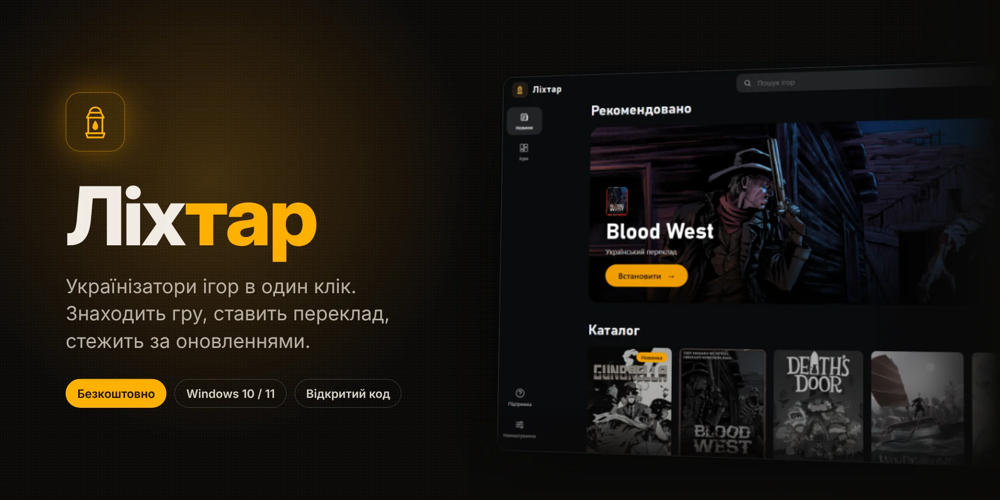
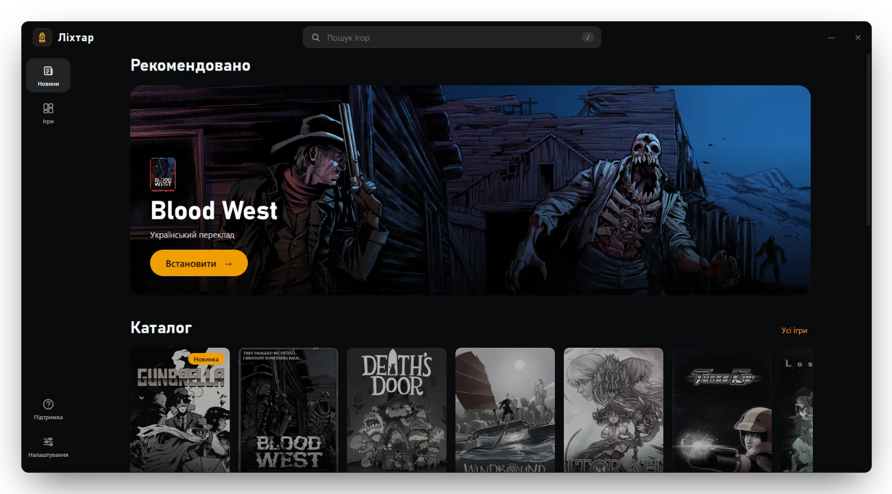
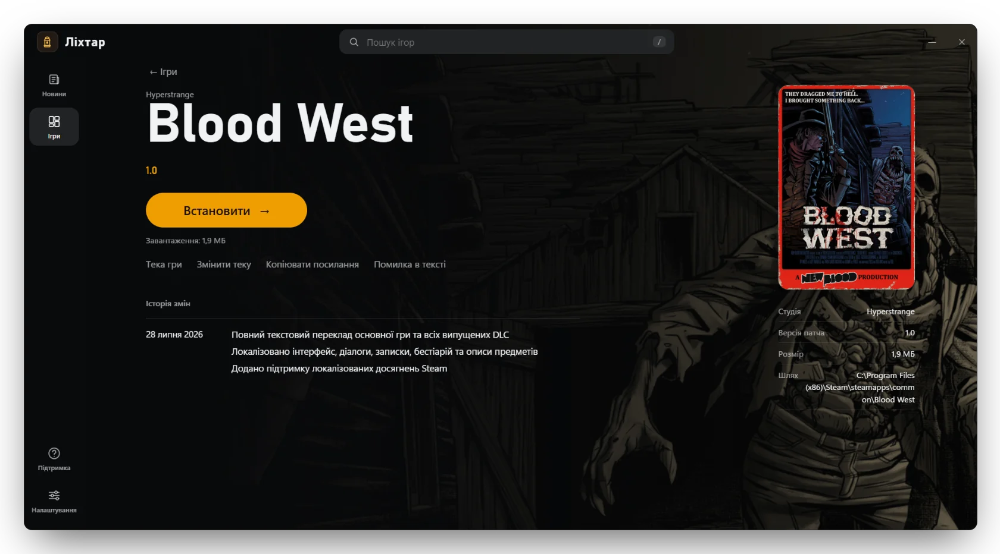
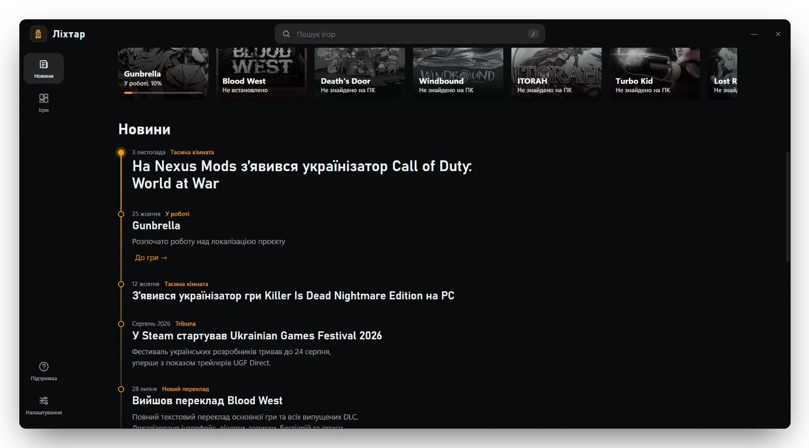
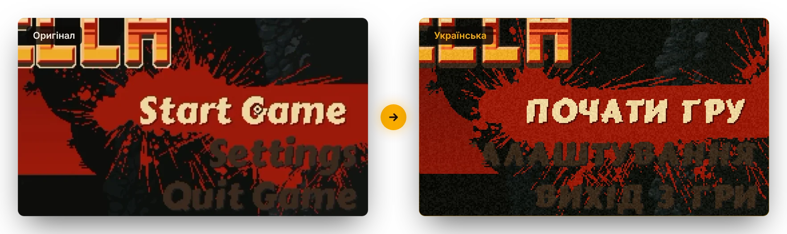
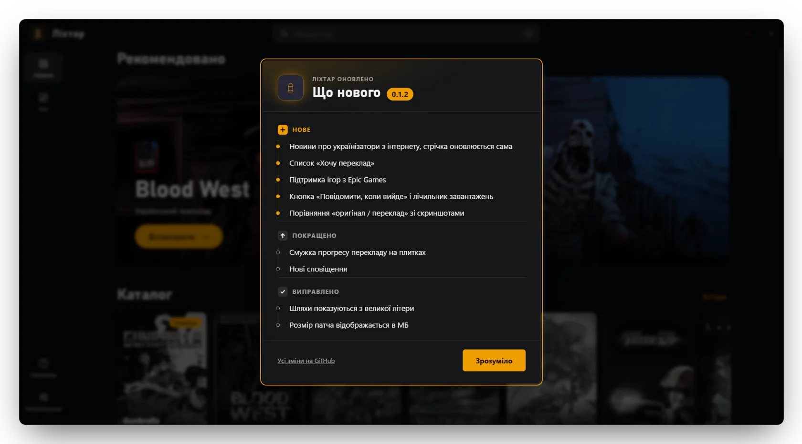

 

  

 

**[Сайт](https://gustihax.github.io/lichtar/)** &nbsp;·&nbsp; **[Каталог перекладів](https://github.com/gustihax/lichtar-catalog)** &nbsp;·&nbsp; **[Хочу переклад](https://github.com/gustihax/lichtar-catalog/issues?q=is%3Aissue+is%3Aopen+label%3Awish)** &nbsp;·&nbsp; **[Повідомити про проблему](https://github.com/gustihax/lichtar/issues)**

 

Ліхтар — безкоштовна програма для Windows, яка ставить українські переклади ігор. Не треба шукати архіви по форумах, читати інструкції й копіювати файли в теки гри: Ліхтар сам знаходить встановлені ігри, ставить переклад одним натиском і повідомляє, коли вийшла нова версія.

Переклади готує спільнота **Тлумачі Світла**.

 

<table>
<tr>
<td width="50%"></td>
<td width="50%"></td>
</tr>
<tr>
<td align="center">Сторінка гри: встановлення, історія змін, де лежить гра</td>
<td align="center">Новини: релізи перекладів і події навколо українізації</td>
</tr>
</table>

## Що вміє

<table>
<tr>
<td width="50%" valign="top">

**Знаходить ігри сам** 
Steam, GOG та Epic Games. Якщо гра стоїть деінде, теку можна вказати вручну.

</td>
<td width="50%" valign="top">

**Безпечне встановлення** 
Перед змінами Ліхтар зберігає оригінальні файли. Гру завжди можна повернути до початкового стану.

</td>
</tr>
<tr>
<td valign="top">

**Оновлення в один клік** 
Вийшла нова версія перекладу — на плитці гри з'явиться позначка, а «Оновити все» поставить усе разом.

</td>
<td valign="top">

**Перевірка цілісності** 
Кожен архів перевіряється за контрольною сумою SHA-256 до того, як потрапить у гру.

</td>
</tr>
<tr>
<td valign="top">

**«Повідомити, коли вийде»** 
Для перекладів, які ще в роботі, видно прогрес. Підпишіться, і Ліхтар скаже, коли переклад з'явиться.

</td>
<td valign="top">

**Новини та «Хочу переклад»** 
Стрічка про українізатори оновлюється сама. А гру, яку хочете бачити українською, можна запропонувати й підтримати голосом.

</td>
</tr>
</table>

## До і після

На сторінці гри можна порівняти оригінал і переклад, перетягуючи повзунок.

## Встановлення

1. Завантажте інсталятор з **[останнього релізу](https://github.com/gustihax/lichtar/releases/latest)** (файл `.exe`).
2. Запустіть його. Встановлення не потребує прав адміністратора.
3. Відкрийте Ліхтар, оберіть гру й натисніть **«Встановити»**.

> [!NOTE]
> Якщо Windows показала вікно **«Windows захистила ваш ПК»**, натисніть **«Докладніше»**, потім **«Все одно виконати»**. Це SmartScreen: він попереджає про будь-яку нову програму без платного сертифіката видавця. Увесь код Ліхтаря відкритий, а кожен реліз збирається публічно в [GitHub Actions](https://github.com/gustihax/lichtar/actions).

Далі Ліхтар оновлюється сам: коли вийде нова версія, у шапці з'явиться кнопка оновлення, а після перезапуску ви побачите, що змінилося.

## Ігри

Список ігор і самі переклади живуть в окремому репозиторії **[lichtar-catalog](https://github.com/gustihax/lichtar-catalog)**. Ліхтар завантажує його під час запуску, тому нові переклади з'являються в програмі одразу, без її оновлення.

Не знайшли свою гру? [Запропонуйте її](https://github.com/gustihax/lichtar-catalog/issues?q=is%3Aissue+is%3Aopen+label%3Awish) або поставте 👍 тій, що вже є в списку: так ми бачимо, що перекладати далі.

**Перекладачам:** як додати свою гру чи випустити оновлення патча, описано в [інструкції для мейнтейнерів](https://github.com/gustihax/lichtar-catalog/blob/main/docs/maintainers.md).

## Ліцензія

[MIT](LICENSE). Програма безкоштовна й такою залишиться. Переклади належать їхнім авторам.

 

Зроблено з любов'ю до української локалізації · Тлумачі Світла

